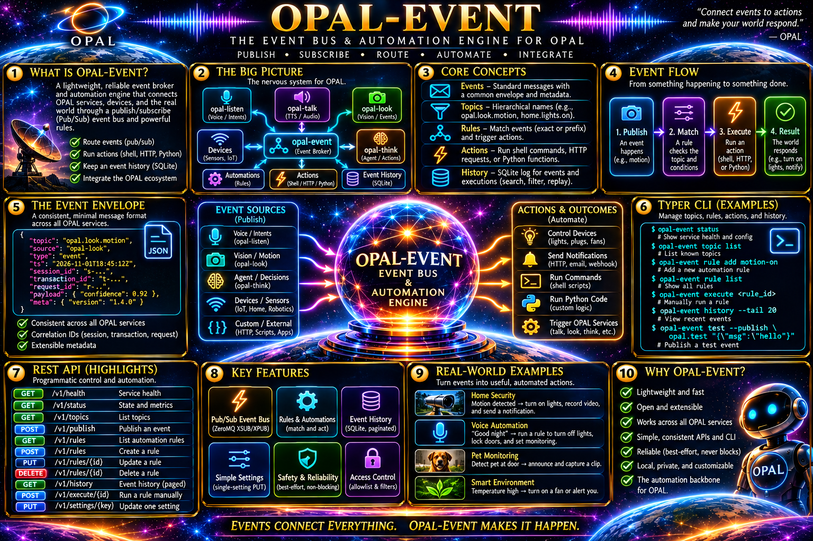

# OPAL Event
### When something happens, make something useful happen.

A camera spots a person. A microphone hears an intent. A sensor crosses a threshold. Something in your software says, **"Hey, this just happened."**

**OPAL Event** takes it from there: it moves events between services, checks simple rules, and kicks off useful actions. Think of it as the nervous system of [OPAL](https://github.com/PatMartin/opal)—a small, fast, understandable bridge between **noticing** and **doing**.

~~~text
opal-look notices a person ───┐
opal-listen recognizes intent ├──▶ OPAL EVENT ──▶ match rule ──▶ run action
a sensor reports a reading ──┘         │                          │
                                       ├── ZeroMQ event bus        ├── shell command
                                       ├── REST API + Typer CLI    ├── HTTP webhook
                                       └── SQLite history         └── Python function
~~~

OPAL Event is deliberately practical:

- **Publish once, let interested services listen.** ZeroMQ XSUB/XPUB provides a lightweight topic-based bus.
- **Express behavior as data.** Match an exact topic or a `prefix.*` pattern, optionally with conditions on JSON fields.
- **Choose your action.** Launch a registered executable/script, call an allowlisted HTTP endpoint, or invoke a Python plugin.
- **See what happened.** Inspect event history, rule tests, execution results, health, and counters.
- **Operate it your way.** REST-first FastAPI service, a Typer CLI, and a browser-based SPA all work with the same API.
- **Keep the brakes.** Bounded workers and queues, timeouts, restricted HTTP destinations, and no automatic retries.

> **Design promise:** It is a *best-effort* event bus, not a durable job queue. A `202 Accepted` publish receipt does **not** mean every subscriber received the event or an action finished. Use execution history to check what actually ran.

## Installation

Requires **Python 3.11+**. The optional web UI also needs **Node.js and npm**. Examples below use Linux/macOS; Windows PowerShell instructions follow.

### 1. Get the code and install the CLI + service

~~~bash
git clone https://github.com/PatMartin/opal-event.git
cd opal-event

python3 -m venv .venv
source .venv/bin/activate
pip install -e ".[dev]"

cp config/opal_event.example.yaml config/opal_event.yaml
mkdir -p var
~~~

For Windows PowerShell, substitute:

~~~powershell
git clone https://github.com/PatMartin/opal-event.git
cd opal-event

py -3 -m venv .venv
.venv\Scripts\Activate.ps1
pip install -e ".[dev]"

Copy-Item config\opal_event.example.yaml config\opal_event.yaml
New-Item -ItemType Directory -Force -Path var
~~~

The install gives you **three commands**:

| Command | What it does |
| --- | --- |
| `opal-event-svc` | Runs the FastAPI + ZeroMQ service |
| `opal event ...` | Unified OPAL Typer command group |
| `opal-event ...` | Shorter alias for the same Event CLI |

The Python distribution currently declares version **1.2.0**; the repository also carries the newer **1.4.0 OpenAPI contract**. These are different version identifiers, not interchangeable names.

`openapi/opal_event_v1.7.1.yaml` is the authoritative contract, with `openapi/shared/opal_kernel.yaml` as the shared OPAL suite kernel. v1.7.1 adds kernel-mounted `/api/v1/profile/` (named presets of portable settings; activation applies a profile to live config atomically, one active at a time), managed backup archives (`/api/v1/backup/list|create|download|restore|delete` as `.tar.gz` bundles), and service process lifecycle (`/api/v1/service/start|stop|log`, pidfile-tracked with start-as-restart). `POST /api/v1/backup/import` now takes the bare config bundle with mandatory `If-Match` (428/412), and personas read back an `origin` field (`local`|`owner`).

### 2. Start the service

~~~bash
opal-event-svc --config config/opal_event.yaml --log-level info
~~~

Keep that terminal open. In a **second terminal**, activate the virtual environment from the repository directory:

~~~bash
source .venv/bin/activate
opal event info health
opal event info health --ready
opal event rules list
~~~

Default local endpoints:

| Purpose | Address |
| --- | --- |
| REST API | `http://127.0.0.1:8080` |
| Swagger UI | `http://127.0.0.1:8080/docs` |
| ZeroMQ producer connection (PUB → XSUB) | `tcp://127.0.0.1:5555` |
| ZeroMQ consumer connection (SUB ← XPUB) | `tcp://127.0.0.1:5556` |

Those ZeroMQ addresses are **not HTTP URLs**. You can change them in the [sample YAML configuration](config/opal_event.example.yaml).

### 3. Publish your first event

~~~bash
opal event publish workshop.hello \
  --data-json '{"message":"The nervous system is awake!"}' \
  --source quickstart

opal event list --topic workshop.hello
opal event info stats
~~~

The sample configuration stores observed events (`persistence.event_mode: all`). Event delivery and observation are asynchronous, so history may not appear instantly.

> **Heads-up:** The example YAML already registers a `front_door_alert` rule and three example actions. Explore them with `opal event rules list` and `opal event actions list`; do not recreate those IDs unless you first remove the existing definitions.

### 4. Optional: run the web console

~~~bash
cd spa
npm install
npm run dev
~~~

Open `http://127.0.0.1:5173`. The Vite dev server proxies API requests to the local service by default. Build for deployment with `npm run build` (output: `spa/dist`).

## The complete Typer command tree

Everything under `opal event` is also available under **`opal-event`**. This tree reflects [the actual Typer implementation](src/opal_event/cli/main.py), not a proposed future interface.

~~~text
opal
└── event                                      (alias: opal-event)
    │
    │  GLOBAL OPTIONS (place after "event", before the subcommand)
    ├── --api-url URL                           default: http://127.0.0.1:8080
    ├── --token TOKEN                           bearer auth, when enabled
    ├── --json                                  raw JSON output
    ├── --timeout SECONDS                       default: 30
    ├── --opal-session-id ID                    correlation header
    ├── --opal-transaction-id ID                correlation header
    ├── --opal-causation-id ID                  correlation header
    │
    ├── publish TOPIC --data-json JSON          [--id UUID] [--source TEXT]
    │                                          [--timestamp RFC3339]
    ├── list                                    [--cursor TOKEN] [--limit N]
    │                                          [--topic TOPIC] [--source TEXT]
    │                                          [--from RFC3339] [--to RFC3339]
    ├── get EVENT_ID
    ├── delete EVENT_ID
    ├── clear                                   delete ALL stored events
    ├── topics
    ├── health                                  [--live | --ready]
    ├── stats
    │
    ├── rules
    │   ├── list
    │   ├── get RULE_ID
    │   ├── create                              [--json JSON | --file PATH | stdin]
    │   ├── update RULE_ID                      [--json JSON | --file PATH | stdin]
    │   │                                      [--if-match ETAG]
    │   ├── delete RULE_ID                      [--if-match ETAG]
    │   └── test RULE_ID --event-json JSON
    │
    ├── actions
    │   ├── list
    │   ├── get ACTION_ID
    │   ├── create                              [--json JSON | --file PATH | stdin]
    │   ├── update ACTION_ID                    [--json JSON | --file PATH | stdin]
    │   │                                      [--if-match ETAG]
    │   ├── delete ACTION_ID                    [--if-match ETAG]
    │   └── execute ACTION_ID --event-json JSON
    │
    ├── executions
    │   ├── list                                [--cursor TOKEN] [--limit N]
    │   │                                      [--status STATUS] [--rule-id ID]
    │   │                                      [--action-id ID] [--event-id ID]
    │   └── get EXECUTION_ID
    │
    ├── settings
    │   ├── get
    │   └── update                              [--json JSON | --file PATH | stdin]
    │                                          [--if-match ETAG]
    │
    └── backup
        ├── export                              [--output PATH]
        ├── validate                            [--json JSON | --file PATH | stdin]
        └── import                              [--json JSON | --file PATH | stdin]
                                               [--if-match ETAG]
~~~

Every level supports `--help`:

~~~bash
opal event --help
opal event rules --help
opal event actions execute --help
opal-event --help
~~~

**Global option gotcha:** `opal event --json rules list` requests machine-readable output; `opal event rules create --json '{"id":...}'` sends a JSON *payload*. The same flag name serves two different purposes depending on its position.

## CLI guide: from first event to useful automations

### Learn the three building blocks

| Building block | Think of it as | Example |
| --- | --- | --- |
| **Event** | "Something happened." | `vision.object.detected` with `{"object":"person"}` |
| **Rule** | "When this event matches these conditions…" | A person appears on a `vision.*` topic |
| **Action** | "…do this." | Run a script, POST a webhook, call Python |

An event is a **topic** and a JSON **data** value, with optional ID, source, and timestamp. A rule combines a topic match with zero or more **AND** conditions. Each matching rule schedules its referenced enabled actions independently.

You don't need to register topics first. Choose descriptive lower-case dotted names like `intent.recognized`, `vision.object.detected`, and `sensor.temperature.reading`.

### Connect to a different service

~~~bash
# Instead of typing the URL for every command:
export OPAL_EVENT_API_URL=http://127.0.0.1:8080
# Only set a token if REST bearer authentication is enabled:
# export OPAL_EVENT_API_TOKEN='your-token'

opal event info health

# Or override the endpoint for one call:
opal event --api-url http://127.0.0.1:8080 --timeout 10 stats

# Use raw JSON output when scripting:
opal event --json rules list
~~~

Supported variables: `OPAL_EVENT_API_URL`, `OPAL_EVENT_API_TOKEN`, `OPAL_SESSION_ID`, `OPAL_TRANSACTION_ID`, and `OPAL_CAUSATION_ID`.

For create/update/import requests, supply a JSON body three ways:

~~~bash
opal event rules create --json '{"id":"example","enabled":false,"topic":"demo.test","conditions":[],"actions":[]}'
opal event rules create --file my-rule.json
cat my-rule.json | opal event rules create
~~~

These are **alternative** ways to send a payload; don't run all three with the same rule ID.

### Use case 1: Give your event bus a voice (a harmless hello)

Let's connect a real event to a real action. First register an action that runs `/bin/echo`. Then add a rule that calls it when someone is greeted.

~~~bash
# Register an action. Shell mode "exec" uses an argv array, not a shell command string.
opal event actions create --json '{
  "id": "demo_greet",
  "type": "shell",
  "enabled": true,
  "mode": "exec",
  "executable": "/bin/echo",
  "args": ["Hello, {{data.name}}!"],
  "stdin": "none",
  "timeout_seconds": 10
}'

# Connect that action to a topic with a simple condition.
opal event rules create --json '{
  "id": "demo_greeting_rule",
  "enabled": true,
  "topic": "demo.greeting",
  "conditions": [
    {"path":"data.name","operator":"exists","value":true}
  ],
  "actions": ["demo_greet"]
}'

# Dry-run the rule: check the match WITHOUT running the action.
opal event rules test demo_greeting_rule \
  --event-json '{"topic":"demo.greeting","data":{"name":"Ada"}}'

# Now make it happen.
opal event publish demo.greeting --data-json '{"name":"Ada"}' --source demo

# Observe the execution record (it may arrive shortly after publishing).
opal event executions list --rule-id demo_greeting_rule
~~~

You should see a rule-test result with `"matched": true`, followed by an execution record. Use `opal event executions get EXECUTION_ID` to inspect the exact status, output, and any error.

Or invoke the action directly—no matching rule needed:

~~~bash
opal event actions execute demo_greet \
  --event-json '{"topic":"demo.manual","data":{"name":"Grace"}}'
~~~

An execute request **schedules** work; the returned execution record and its later status tell you how it went.

When you're finished:

~~~bash
opal event rules delete demo_greeting_rule
opal event actions delete demo_greet
~~~

Delete the rule first because it references the action. These cleanup commands leave unrelated events intact.

### Use case 2: Your camera sees someone at the front door

The sample configuration comes with an illustrative OPAL Look → OPAL Event path: `front_door_alert` matches `vision.*` events when `data.object` is `person`.

~~~bash
# Inspect the preconfigured pieces.
opal event rules get front_door_alert
opal event actions get announce_person
opal event actions get send_notification

# Test the rule safely.
opal event rules test front_door_alert --event-json '{
  "topic": "vision.object.detected",
  "source": "opal-look",
  "data": {"object":"person","camera":"front_door","confidence":0.94}
}'

# Publish a simulated detection.
opal event publish vision.object.detected \
  --source opal-look \
  --data-json '{"object":"person","camera":"front_door","confidence":0.94}'

# Inspect activity and failures, if any.
opal event executions list --rule-id front_door_alert
opal event executions list --status failed
~~~

The sample `announce_person` action writes a message with `/bin/echo`; the sample `send_notification` action POSTs to `http://127.0.0.1:9000/notify`. **That receiver isn't included or started by this project.** The HTTP execution may fail until you run a receiver there. A successful rule match does not guarantee successful actions.

This is the same flow you can use with a genuine OPAL Look producer—just send the real camera's normalized event instead of the CLI simulation.

### Use case 3: A garage sensor raises an alert above a threshold

Make an independent rule that reacts only to a sufficiently hot garage. This shows **numeric comparisons**, **multiple conditions**, and **topic specificity**.

~~~bash
opal event actions create --json '{
  "id":"demo_heat_log",
  "type":"shell",
  "enabled":true,
  "mode":"exec",
  "executable":"/bin/echo",
  "args":["Garage heat alert: {{data.celsius}} C"],
  "stdin":"none"
}'

opal event rules create --json '{
  "id":"demo_garage_hot",
  "enabled":true,
  "topic":"sensor.temperature.reading",
  "conditions":[
    {"path":"data.zone","operator":"eq","value":"garage"},
    {"path":"data.celsius","operator":"gte","value":35}
  ],
  "actions":["demo_heat_log"]
}'

# This should NOT match.
opal event rules test demo_garage_hot \
  --event-json '{"topic":"sensor.temperature.reading","data":{"zone":"garage","celsius":24}}'

# This should match, still without executing anything.
opal event rules test demo_garage_hot \
  --event-json '{"topic":"sensor.temperature.reading","data":{"zone":"garage","celsius":38.5}}'

# Live event: now the action can run.
opal event publish sensor.temperature.reading \
  --source garage-sensor \
  --data-json '{"zone":"garage","celsius":38.5}'
~~~

Need to quiet it temporarily? Disable the rule without deleting it:

~~~bash
opal event rules update demo_garage_hot --json '{"enabled":false}'
opal event rules get demo_garage_hot
# When ready: opal event rules update demo_garage_hot --json '{"enabled":true}'
~~~

Clean up by deleting `demo_garage_hot` and then `demo_heat_log`.

### Use case 4: Route an OPAL Listen intent into an automation

Voice is more useful when a recognized phrase can *cause* something. Suppose OPAL Listen emits `intent.recognized` with the structured intent `lights.turn_on`.

~~~bash
opal event actions create --json '{
  "id":"demo_voice_ack",
  "type":"shell",
  "enabled":true,
  "mode":"exec",
  "executable":"/bin/echo",
  "args":["Recognized intent: {{data.intent}}"],
  "stdin":"none"
}'

opal event rules create --json '{
  "id":"demo_lights_intent",
  "enabled":true,
  "topic":"intent.recognized",
  "conditions":[
    {"path":"data.intent","operator":"eq","value":"lights.turn_on"}
  ],
  "actions":["demo_voice_ack"]
}'

opal event publish intent.recognized --source opal-listen \
  --data-json '{"intent":"lights.turn_on","room":"office"}'

opal event executions list --rule-id demo_lights_intent
~~~

The example *acknowledges* the intent with an echo. It does **not** actually switch on a light. To do that, replace the action with a trusted local script, an HTTP action targeting your own approved home-automation endpoint, or a Python plugin. This separation is intentional: **recognition, decision, execution** stay independently testable.

### Use case 5: Call an HTTP webhook when a rule matches

HTTP actions are great for a home-automation service, dashboard, notification gateway, or another OPAL component.

~~~bash
opal event actions create --json '{
  "id":"demo_notify_webhook",
  "type":"http",
  "enabled":true,
  "method":"POST",
  "url":"http://127.0.0.1:9000/notify",
  "body_mode":"template",
  "body":{
    "kind":"heat_alert",
    "zone":"{{data.zone}}",
    "celsius":"{{data.celsius}}"
  },
  "timeout_seconds":15
}'

# Try it manually with sample event data.
opal event actions execute demo_notify_webhook --event-json '{
  "topic":"sensor.temperature.reading",
  "data":{"zone":"garage","celsius":38.5}
}'
~~~

The example configuration **allows HTTP actions only to** `http://127.0.0.1:9000`. You must supply a server handling `POST /notify` for success. To route this action automatically, add its ID to a matching rule's `actions` list, e.g. the garage rule from Use case 3, and re-enable that rule.

> Template values like `{{data.celsius}}` preserve their JSON number type when they occupy the entire string. Text such as `"Alert: {{data.celsius}}"` is rendered as a string. Missing fields cause a template error rather than silently inventing a value.

### Use case 6: Use Python instead of shell or HTTP

The repository includes a small runnable example module:

~~~bash
opal event actions get process_detection

opal event actions execute process_detection --event-json '{
  "topic":"vision.object.detected",
  "data":{"object":"person","camera":"driveway"}
}'
~~~

The preconfigured `process_detection` action calls `opal_event.plugins.example.handle_event`. Custom Python actions register an importable `module` and `function`, with the function receiving the event dictionary and returning JSON-serializable output. They run in a separate child interpreter; that is **process isolation, not a sandbox** for untrusted code.

### Use case 7: Explore what happened (and why)

The CLI is also a compact troubleshooting console.

~~~bash
# Recent observed events
opal event list --limit 20
opal event list --topic vision.object.detected --source opal-look
opal event topics

# Recent action runs
opal event executions list --limit 20
opal event executions list --status failed
opal event executions list --action-id announce_person
opal event executions get EXECUTION_ID

# Operational view
opal event info health
opal event info health --live
opal event info health --ready
opal event info stats
opal event settings get
~~~

Useful details:

- Event history supports `--cursor`, `--limit` (up to 200), `--topic`, `--source`, `--from`, and `--to`. Timestamps use RFC3339.
- Execution history supports `--cursor`, `--limit` (up to 500), `--status`, `--rule-id`, `--action-id`, and `--event-id`.
- Rules and actions are **bounded catalogs**, not cursor-paginated lists.
- `opal event --json executions list` and the other formatted collection commands print JSON arrays, making them convenient for `jq` pipelines.
- `opal event clear` deletes **all stored event history**. It does not disable rules; use it cautiously.

With `jq` installed:

~~~bash
opal event --json executions list | jq '.[] | {id, action_id, status}'
opal event --json rules list | jq '.[] | select(.enabled) | .id'
~~~

If the rule never matches, start with `rules test`. If it matches but nothing runs, inspect whether its actions are enabled and whether executions were dropped. If an action runs but fails, inspect its execution record and the server logs.

### Use case 8: Tune the service while it's running

Portable settings can be updated through the REST API without editing YAML by hand.

~~~bash
opal event settings get

# Increase the number of execution workers and change timeout.
opal event settings update --json '{
  "execution":{"max_workers":6,"default_timeout_seconds":20}
}'

# Record only events that matched rules.
opal event settings update --json '{
  "persistence":{"event_mode":"matched","retention_days":7}
}'
~~~

`event_mode` supports `all`, `matched`, or `none`. Execution history is a separate setting. Updates to workers, queues, rules, actions, and other portable settings are applied live; changes to network bindings, REST authorization, CURVE credentials, or the SQLite path need a restart.

**Concurrency protection:** `rules update/delete`, `actions update/delete`, `settings update`, and `backup import` use strong ETags. The CLI normally fetches the current ETag for you. Use `--if-match ETAG` when you specifically need to reject a change if someone else edited the resource.

### Use case 9: Take a configuration snapshot before experimenting

~~~bash
# Save a portable snapshot (rules, actions, portable settings).
opal event backup export --output opal-event-backup.json

# Check that the snapshot is structurally valid; makes no changes.
opal event backup validate --file opal-event-backup.json
~~~

To **import**, the API expects a wrapper shaped `{"backup": <exported-config>}`, not the raw export. For example, with `jq`:

~~~bash
jq -n --slurpfile b opal-event-backup.json '{backup:$b[0]}' \
  > opal-event-import.json

opal event backup import --file opal-event-import.json
~~~

**Important:** Import replaces the portable settings/rules/actions catalog atomically. The backup **does not** include database history, bearer tokens, CURVE secrets, network bindings, or the database path. Treat it as a *configuration* snapshot, not a full disaster-recovery backup.

### A quick rule-writing cheat sheet

| Feature | Meaning | Example |
| --- | --- | --- |
| Exact topic | One topic only | `vision.object.detected` |
| Hierarchical wildcard | Descendant topics; not the bare prefix | `vision.*` |
| Field path | Dotted path within event JSON | `data.camera` |
| `eq` / `ne` | Strict equality / inequality | Person vs. vehicle |
| `gt` / `gte` / `lt` / `lte` | Numeric comparison | Temperature ≥ 35 |
| `in` / `not_in` | Membership in a list | One of several intents |
| `exists` | Field present or absent | `{"value":true}` |
| `contains` | String substring or array element | A tag or message fragment |

All conditions in a rule must pass. There is no OR expression language in the current rule model; split different scenarios into separate rules.

## How it works under the hood

~~~text
             external ZeroMQ PUB clients
                        │
                        ▼  port 5555 (default)
                      XSUB  ─────── ZeroMQ proxy ─────── XPUB ──▶ external SUB clients
                                                    port 5556
                        │
                        └── internal observer (its own copy)
                                 │
                                 ├── validate + normalize
                                 ├── match enabled rules ──▶ bounded executor ──▶ actions
                                 └── store history (by persistence mode)
                                              │
                                            SQLite

     REST POST /api/v1/event/ ──▶ service-owned PUB ──▶ XSUB
     Typer CLI ──────────────────▶ REST API
     React SPA ──────────────────▶ REST API
~~~

The ZeroMQ proxy forwards messages as a best-effort transport. The internal observer validates and processes its own copy. REST publications enter through the same ZeroMQ ingress as external producers; they do **not** bypass the observer to call rules directly.

### REST-first by design

The [OpenAPI contract](openapi/opal_event_v1.7.1.yaml) describes the interface. The CLI and SPA are API clients—not independent implementations of business logic. You can use Swagger UI at `/docs`, or build another client against the same API.

| Interface | Role |
| --- | --- |
| `/api/v1/event/` | Publish and inspect stored events |
| `/api/v1/topic/` | List observed topics |
| `/api/v1/rule/` | Manage and test rules |
| `/api/v1/action/` | Manage and manually execute actions |
| `/api/v1/execution/` | Inspect execution history |
| `/api/v1/setting/` | Read/update portable settings |
| `/api/v1/backup/*` | Export/validate/import portable configuration |
| `/api/v1/health/`, `/api/v1/stats/` | Operational health and counters |

### If you publish or subscribe over raw ZeroMQ

The wire format is **two multipart frames**: an ASCII topic and a UTF-8 JSON envelope. For example:

~~~text
frame 1: vision.object.detected
frame 2: {"topic":"vision.object.detected","source":"opal-look","data":{"object":"person","camera":"front_door"}}
~~~

A publisher connects a ZeroMQ `PUB` socket to `tcp://127.0.0.1:5555`; a subscriber connects `SUB` to `tcp://127.0.0.1:5556`. Raw SUB filtering is **byte-prefix-based** (subscribe to `vision.`), whereas OPAL rules use application patterns like `vision.*`. Those are related, but **not identical**.

Messages are limited to 1 MiB total across both frames. There are no subscriber acknowledgments, replay guarantees, exactly-once semantics, or automatic retries. A newly connected PUB/SUB peer can lose early messages while subscriptions propagate ("slow joiner"). See the [wire protocol](specs/zeromq_protocol.md) for framing, security, and Python examples.

## Configuration, safety, and operations

The example YAML has the main knobs in one place:

~~~yaml
server:
  host: 127.0.0.1
  port: 8080
execution:
  max_workers: 4
  queue_size: 100
  default_timeout_seconds: 30
  overflow: drop_and_log
  retry_enabled: false
persistence:
  database: var/opal_event.db
  event_mode: all
  retention_days: 7
  execution_history_enabled: true
~~~

- **Keep external access deliberate.** Default bindings are loopback-only. Exposing the service beyond localhost requires REST bearer authentication; secure external ZeroMQ access with CURVE and trusted client keys.
- **Shell actions use argv, not an interpolated shell command.** The `exec` mode uses a registered executable; interpreter modes use a registered script path. Event text must not become executable code.
- **HTTP actions use destination allowlists.** A URL must pass scheme/host/port and address checks. An arbitrary event cannot select an arbitrary internet destination.
- **Python plugins are trusted code.** A child process is not a hostile-code sandbox.
- **The queue has limits.** Excess work can be recorded as `dropped` (`queue_full`). Action execution can fail or time out; it is not automatically retried.
- **History is observability, not replay.** SQLite holds observed events according to the persistence mode and records executions separately; retention cleanup runs periodically.
- **Reload behavior matters.** Rule/action and portable changes can take effect live. Transport bindings, CURVE settings, REST auth, and database path changes require a restart.

For deployments and troubleshooting, see [the full user guide](docs/USER_GUIDE.md), [CLI reference](docs/CLI.md), and [ZeroMQ specification](specs/zeromq_protocol.md).

## Develop, test, and measure

~~~bash
# Python tests and static checks
pytest
ruff check src tests

# Standalone regression script
python regression_test.py

# Optional isolated performance probe (not part of normal CI)
python benchmark.py --duration 15 --rule-counts 1,25

# Frontend checks
cd spa
npm run typecheck
npm run build
~~~

The test suite has unit, integration, contract, security, and end-to-end coverage. The benchmarking script measures publication, observation, matching, execution, and queue pressure; throughput is host-dependent.

## Project map

~~~text
opal-event/
├── opal-event.png                 project artwork
├── README.md                      this guide
├── pyproject.toml                 package + CLI entry points
├── openapi/opal_event_v1.7.1.yaml  OpenAPI contract
├── config/opal_event.example.yaml
├── examples/                      sample JSON payloads
├── docs/CLI.md                    detailed command reference
├── docs/USER_GUIDE.md             extended operator guide
├── specs/zeromq_protocol.md       wire protocol and delivery semantics
├── src/opal_event/
│   ├── cli/                       Typer REST client
│   ├── routers/                   FastAPI routes
│   ├── zeromq_broker.py           event transport and observer
│   ├── rules.py                   topic/condition matching
│   ├── actions/                   shell, HTTP, Python runners
│   ├── executor.py                bounded work pool
│   ├── config.py                  YAML settings and reload
│   └── db.py                      SQLite persistence
├── spa/                           React + TypeScript + Vite
└── tests/                         unit, integration, contract, security, E2E
~~~

---

**OPAL Event doesn't need to be the smartest service in the room.** It just needs to reliably connect the services that notice things with the ones that can do something useful about them—while making every rule, action, and failure easy to understand.

**Explore the rest of OPAL:** [OPAL](https://github.com/PatMartin/opal) · [OPAL Look](https://github.com/PatMartin/opal-look) · [OPAL Listen](https://github.com/PatMartin/opal-listen) · [OPAL Talk](https://github.com/PatMartin/opal-talk) · [OPAL Think](https://github.com/PatMartin/opal-think)
