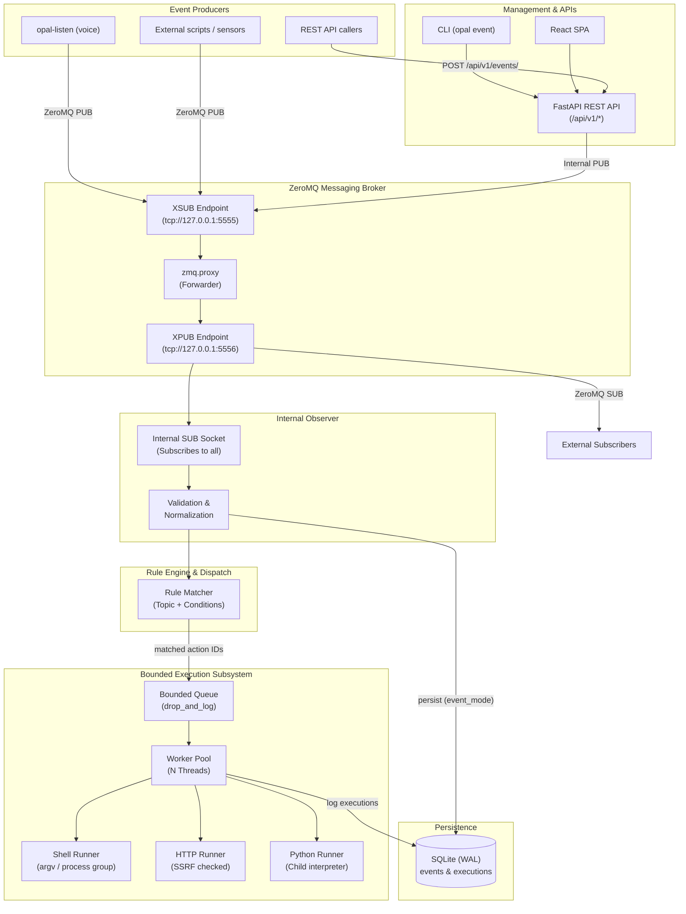
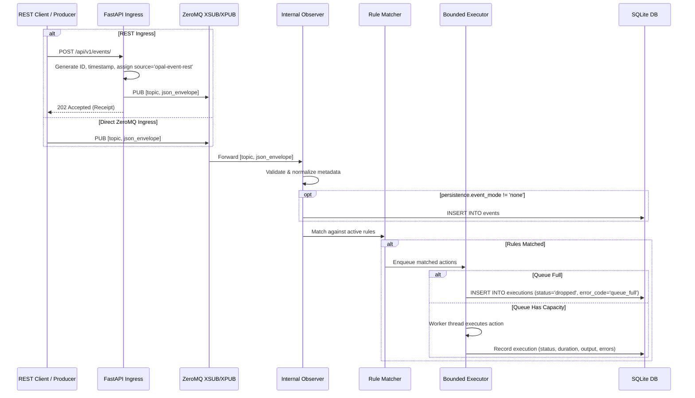

# opal_event User Guide

`opal_event` is the local event bus, lightweight rule engine, and bounded action-execution service
for Raspberry Pi 5, Linux, and Windows in the OPAL stack. It ingests events from external producers
(such as `opal_listener` wakeword/intent detections or vision system alerts), evaluates topic patterns
and boolean conditions against configured rules, and dispatches actions (shell commands, outbound HTTP
requests, or Python plugin functions) within strict concurrency and resource limits.

When a message like this arrives on the event bus:

```json
{
  "topic": "vision.object.detected",
  "source": "front_door_cam",
  "data": {
    "object": "person",
    "camera": "front_door",
    "confidence": 0.94
  }
}
```

`opal_event` matches it against rules, renders templated action parameters (e.g. `{{data.camera}}`),
and executes the associated actions while recording complete execution audit logs:

```json
{
  "id": "e4f3a120-8b1e-4c7b-99f2-2a781b0f56d9",
  "action_id": "announce_person",
  "status": "succeeded",
  "trigger": "rule",
  "duration_ms": 14,
  "exit_code": 0,
  "stdout": "person detected at front_door\n"
}
```

There are three ways to interact with `opal_event`, and all three expose the full operational surface:

| Interface | Use it for | Entry point |
|---|---|---|
| REST API | Integrations, automation, third-party services | `http://<host>:8080/api/v1/...`, interactive docs at `/docs` |
| CLI | Terminal administration, shell scripts, CI/CD | `opal event <command>` or `opal-event <command>` |
| Web SPA | Browser-based monitoring, testing, and configuration | `http://<host>:5173` (dev) or web server root |

---

## Table of contents

1. [Concepts](#1-concepts)
2. [Installation](#2-installation)
3. [Architecture](#3-architecture)
4. [Configuration reference](#4-configuration-reference)
5. [REST API reference](#5-rest-api-reference)
6. [ZeroMQ wire protocol & event bus](#6-zeromq-wire-protocol--event-bus)
7. [CLI reference](#7-cli-reference)
8. [Web GUI guide](#8-web-gui-guide)
9. [Recipes and workflows](#9-recipes-and-workflows)
10. [Integrating with your application](#10-integrating-with-your-application)
11. [Testing](#11-testing)
12. [Troubleshooting and FAQ](#12-troubleshooting-and-faq)
13. [Appendix: operation ↔ CLI ↔ GUI map](#13-appendix-operation--cli--gui-map)

---

## 1. Concepts

| Term | Meaning | Example |
|---|---|---|
| **Event** | An immutable record of something that occurred, containing a topic, source, timestamp, and payload `data`. | `{"topic": "vision.object.detected", "data": {"object": "person"}}` |
| **Topic** | A dot-separated hierarchical namespace string identifying the kind of event. Restricted to lowercase alphanumeric ASCII, underscores, hyphens, and dots. | `vision.object.detected`, `intent.recognized` |
| **Rule** | A declarative mapping from an event topic pattern and a set of conditions to one or more action IDs. | Topic `vision.*` + `data.object == "person"` → execute `announce_person` |
| **Condition** | A boolean expression evaluating a dotted JSON path in the event against an expected value using an operator. | `path: "data.confidence"`, `operator: "gte"`, `value: 0.85` |
| **Action** | An executable task definition: a local shell process, an outbound HTTP call, or an isolated Python plugin function. | `type: "shell"`, `executable: "/bin/echo"`, `args: ["{{data.object}}"]` |
| **Execution** | A persistent audit record tracking the lifecycle, status, timestamps, duration, exit codes, output, and errors of an action run. | Status: `succeeded`, `exit_code: 0`, `duration_ms: 12` |
| **Bounded Executor** | A fixed-size worker pool with a bounded in-memory queue. Overflows are dropped and logged to prevent system thrashing. | 4 worker threads, queue capacity 100, overflow policy `drop_and_log` |
| **ZeroMQ Broker** | An in-process `XSUB`/`XPUB` proxy forwarding multipart messages between producers and consumers with optional CURVE encryption. | Inbound `tcp://127.0.0.1:5555`, Outbound `tcp://127.0.0.1:5556` |
| **Internal Observer** | A service-owned subscriber connected to the broker that validates events, persists history, evaluates rules, and enqueues actions. | |
| **Hot Reloading** | Live configuration reload for rules, actions, execution parameters, and persistence settings without restarting the service. | Managed via file watcher (`watchfiles`) or REST API mutations |
| **Portable Settings** | The runtime-tunable subset of configuration that carries no machine-specific bindings, secrets, or file paths. | `max_workers`, `queue_size`, `event_mode`, `retention_days` |
| **Config Backup** | A portable, version-controllable JSON bundle containing all rules, actions, and portable settings. | Format version 1 export/import bundle |
| **Optimistic Concurrency** | Concurrency control using strong `ETag` revisions and `If-Match` headers to prevent lost updates across concurrent clients. | HTTP `428 Precondition Required`, `412 Precondition Failed` |
| **OPAL Context Headers** | Suite-standard correlation identifiers (`X-Opal-Session-Id`, `X-Opal-Transaction-Id`, `X-Opal-Causation-Id`, `X-Opal-Request-Id`) traced across hops. | |

### Topic matching rules

Topics follow a hierarchical dot-separated namespace. In the rule engine, two match types are supported:

| Pattern | Rule match behavior | Matches | Does NOT match |
|---|---|---|---|
| `exact.name` | Exact topic equality | `exact.name` | `exact.name.sub`, `exact` |
| `prefix.*` | Matches all descendant sub-topics | `prefix.foo`, `prefix.foo.bar` | bare `prefix`, `prefixother` |

> **Contrast with ZeroMQ SUB sockets:** ZeroMQ subscriptions operate on raw byte prefixes. Subscribing to
> `prefix.` in ZeroMQ receives all descendants, but subscribing to `prefix` would also receive `prefixother`.
> The OPAL Event rule engine strictly adheres to dot-boundary semantics.

### Condition operators

All conditions within a rule are combined using logical **AND**. A missing path evaluates to false, except
when testing `exists` with `value: false`.

| Operator | Type requirements | Evaluates to true when | Notes |
|---|---|---|---|
| `eq` | Any | `resolved_value == expected_value` | Strict equality |
| `ne` | Any | `resolved_value != expected_value` | Strict inequality |
| `gt` | Numbers (`int`, `float`) | `resolved_value > expected_value` | Booleans are strictly excluded |
| `gte` | Numbers (`int`, `float`) | `resolved_value >= expected_value` | Booleans are strictly excluded |
| `lt` | Numbers (`int`, `float`) | `resolved_value < expected_value` | Booleans are strictly excluded |
| `lte` | Numbers (`int`, `float`) | `resolved_value <= expected_value` | Booleans are strictly excluded |
| `in` | Array | `resolved_value in expected_value` | Target value must be a JSON list |
| `not_in` | Array | `resolved_value not in expected_value` | Target value must be a JSON list |
| `exists` | Boolean | Path presence == expected boolean | `value: false` asserts path is missing |
| `contains`| String or List | Substring in string, or item in list | |

### Action types and templating

OPAL Event supports three action types:

1. **Shell Action (`shell`)**: Executes local binaries or scripts (`exec`, `sh`, `bash`, `cmd`, `powershell`).
   Always executed with `shell=False` (arguments passed as an `argv` array) in an isolated process group.
2. **HTTP Action (`http`)**: Sends outbound HTTP requests (`GET`, `POST`, `PUT`, `PATCH`, `DELETE`) with
   strict destination allowlisting, per-request DNS resolution, link-local blocking, and disabled redirects.
3. **Python Plugin Action (`python`)**: Spawns an isolated child Python interpreter executing a registered
   module and function (`module.function(event) -> dict`) with standard I/O communication.

#### Templating syntax

Placeholders enclosed in `{{ ... }}` are evaluated against the triggering event:
- `{{event}}`: Expands to the entire event object.
- `{{data.path}}`: Navigates into the event payload. Dotted keys access dictionaries, numeric parts access lists.
- **Type preservation:** When a template string consists *only* of a placeholder (e.g. `body: "{{data.reading}}"`),
  the native type (integer, float, boolean, dictionary, list) is preserved without string conversion.
- **String interpolation:** When embedded in other text (e.g. `args: ["temp is {{data.reading}}C"]`), values
  are formatted as strings.

---

## 2. Installation

### 2.1 Prerequisites

- Linux (x86_64 or aarch64 / Raspberry Pi 5), macOS, or Windows
- Python **3.11–3.13**
- libzmq (installed automatically via `pyzmq` wheels on most platforms)
- Node.js ≥ 18 and npm (only needed if building or developing the React SPA)

### 2.2 Install from source

```bash
cd /gh/opal/opal-event
python3 -m venv .venv
source .venv/bin/activate
pip install -e ".[dev]"
```

This installs three console commands:

| Command | Purpose |
|---|---|
| `opal-event-svc` | The core service runtime (REST API, ZeroMQ broker, executor, observer) |
| `opal` | The unified OPAL CLI (`opal event ...`) |
| `opal-event` | Standalone shortcut for the `opal event` CLI |

### 2.3 Directory and configuration setup

Prepare the working configuration and database directory:

```bash
mkdir -p var config
cp config/opal_event.example.yaml config/opal_event.yaml
```

### 2.4 Environment variables

| Variable | Default | Purpose |
|---|---|---|
| `OPAL_EVENT_CONFIG` | `config/opal_event.yaml` | Path to the YAML configuration file |
| `OPAL_EVENT_API_URL` | `http://127.0.0.1:8080` | Default REST API base URL used by the CLI |
| `OPAL_EVENT_API_TOKEN` | None | Bearer token sent by the CLI when REST auth is enabled |
| `OPAL_SESSION_ID` | None | Default session correlation ID sent by the CLI |
| `OPAL_TRANSACTION_ID` | None | Default transaction correlation ID sent by the CLI |
| `OPAL_CAUSATION_ID` | None | Default causation correlation ID sent by the CLI |

### 2.5 First start

Start the core service:

```bash
opal-event-svc --config config/opal_event.yaml --log-level info
```

On startup, `opal-event-svc`:
1. Validates the YAML configuration file.
2. Initializes the SQLite database (`var/opal_event.db`) in WAL mode and creates tables if missing.
3. Binds the ZeroMQ XSUB (publishers) and XPUB (subscribers) sockets.
4. Starts the bounded executor worker pool.
5. Connects the internal observer subscriber.
6. Starts the configuration filesystem watcher for hot reloading.
7. Binds the FastAPI REST API server (Uvicorn).

Useful URLs:
- REST API Root: `http://127.0.0.1:8080/`
- Interactive Swagger UI: `http://127.0.0.1:8080/docs`
- OpenAPI Specification: `http://127.0.0.1:8080/openapi.json`
- Liveness Probe: `http://127.0.0.1:8080/api/v1/health/live`
- Readiness Probe: `http://127.0.0.1:8080/api/v1/health/ready`

### 2.6 Verifying the installation

In a separate terminal, test the service using the CLI:

```bash
# Verify health
opal event health

# Verify liveness and readiness
opal event health --live
opal event health --ready

# Inspect metrics
opal event stats

# Publish a test event
opal event publish test.hello --data-json '{"message": "world"}'

# List recent events
opal event list --limit 5
```

### 2.7 Running the Web SPA

The React + TypeScript + Vite SPA provides a rich web dashboard.

#### Development server (with `/api` proxy)

```bash
cd spa
npm install
npm run dev
```

Open `http://127.0.0.1:5173` in your browser. Requests to `/api` are automatically proxied to the
backend at `http://127.0.0.1:8080`.

#### Production build

```bash
cd spa
npm run build
```

This compiles static assets into `spa/dist`. You can serve `spa/dist` using nginx, Caddy, or any static
file server configured to reverse-proxy `/api` to the REST backend.

### 2.8 Running as a systemd service (Linux)

Create `/etc/systemd/system/opal-event.service`:

```ini
[Unit]
Description=Opal Event Service
After=network.target

[Service]
Type=simple
User=opal
WorkingDirectory=/opt/opal-event
Environment=OPAL_EVENT_API_TOKEN=your-secure-token
ExecStart=/opt/opal-event/.venv/bin/opal-event-svc --config /opt/opal-event/config/opal_event.yaml --log-level info
Restart=on-failure
RestartSec=3

[Install]
WantedBy=multi-user.target
```

Enable and start the service:

```bash
sudo systemctl daemon-reload
sudo systemctl enable --now opal-event
sudo systemctl status opal-event
```

### 2.9 Upgrading

```bash
git pull
pip install -e ".[dev]"
opal event backup export --output backup_pre_upgrade.json
sudo systemctl restart opal-event
opal event health --ready
```

---

## 3. Architecture

### 3.1 Big picture



### 3.2 Ingress and normalization flow



### 3.3 Key architectural principles

1. **Unified Event Ingress**: The REST endpoint (`POST /api/v1/events/`) does not execute rules directly.
   Instead, it publishes the normalized event into the same ZeroMQ broker socket used by external producers.
   The internal observer processes all events identically, ensuring uniform semantics across transports.
2. **Best-Effort ZeroMQ Broker**: The XSUB/XPUB proxy is a lightweight forwarder. It does not validate,
   filter, or buffer messages. Only the internal observer validates messages and tracks metrics.
3. **Bounded Resource Execution**: To guarantee system stability on embedded hardware like Raspberry Pi,
   the action execution queue has a strict capacity (`queue_size`). When workers are busy and the queue fills,
   new actions are dropped and recorded with `status: "dropped"` (`drop_and_log`). The service never leaks
   unbounded memory or retries indefinitely.
4. **Isolated Subprocess Execution**:
   - Shell commands execute with `shell=False` in an independent process group. If an action times out,
     the entire process tree is terminated (`killpg` or `taskkill`).
   - Python plugins execute in a separate unprivileged child process using stdin/stdout JSON streaming.
5. **Strict Network Egress Security**: Outbound HTTP actions resolve DNS on every request and block
   loopback/link-local/metadata IP ranges, guarding against Server-Side Request Forgery (SSRF).

---

## 4. Configuration reference

Configuration is loaded from a single YAML file (`config/opal_event.yaml`).

### 4.1 Annotated configuration schema

```yaml
version: 1

# Server bindings (Requires service restart)
server:
  host: 127.0.0.1             # Bind IP address (non-loopback requires rest_auth)
  port: 8080                  # REST API port

# ZeroMQ Broker endpoints (Requires service restart)
zeromq:
  publishers: tcp://127.0.0.1:5555    # Inbound XSUB socket for producers
  subscribers: tcp://127.0.0.1:5556   # Outbound XPUB socket for consumers
  max_event_bytes: 1048576            # Maximum allowed event message size (1 MiB ceiling)
  curve:
    enabled: false                    # Set true to enable CURVE encryption/auth
    server_public_key_file: null      # Path to server .key file
    server_secret_key_file: null      # Path to server .key_secret file
    authorized_client_keys_file: null # Directory containing authorized client *.key files

# Security and authorization
security:
  rest_auth:                          # (Requires service restart)
    enabled: false                    # Enforce HTTP Bearer token authentication
    token_env: OPAL_EVENT_API_TOKEN   # Environment variable holding the valid token
  http_action_allowlist:              # (Hot-reloadable) Destination allowlist for HTTP actions
    - host: 127.0.0.1
      ports: [9000]
      schemes: [http]
    - host: api.homeassistant.local
      ports: [8123]
      schemes: [http, https]

# Action execution worker pool (Hot-reloadable)
execution:
  max_workers: 4                      # Number of concurrent worker threads
  queue_size: 100                     # Capacity of in-memory execution queue
  default_timeout_seconds: 30         # Default execution timeout if unspecified in action
  overflow: drop_and_log              # Overflow policy: drop action and log execution record
  retry_enabled: false                # Retries are disabled in v1
  max_output_bytes: 65536             # Max bytes of stdout/stderr captured (64 KiB)

# SQLite persistence settings
persistence:
  database: var/opal_event.db         # Path to SQLite database file (Requires restart)
  event_mode: all                     # Events to persist: 'all', 'matched', or 'none' (Hot-reloadable)
  retention_days: 7                   # Retention period before purge (Hot-reloadable)
  execution_history_enabled: true     # Execution history is always recorded

# Action definitions catalog (Hot-reloadable)
actions:
  - id: announce_person
    type: shell
    enabled: true
    mode: exec
    executable: /bin/echo
    args: ["person detected at {{data.camera}}"]
    stdin: none
    timeout_seconds: 10

  - id: notify_home_assistant
    type: http
    enabled: true
    method: POST
    url: http://127.0.0.1:9000/notify
    body_mode: template
    body:
      camera: "{{data.camera}}"
      detected_object: "{{data.object}}"
    timeout_seconds: 15

  - id: process_detection
    type: python
    enabled: true
    module: opal_event.plugins.example
    function: handle_event
    timeout_seconds: 10

# Rule definitions catalog (Hot-reloadable)
rules:
  - id: front_door_alert
    enabled: true
    topic: vision.*
    conditions:
      - path: data.object
        operator: eq
        value: person
    actions:
      - announce_person
      - notify_home_assistant
```

### 4.2 Restart-only vs. Hot-reloadable fields

| Category | Field | Behavior |
|---|---|---|
| **Restart-only** | `server.host`, `server.port` | Bound at startup. Modifying on disk marks `pending_restart: true`. |
| **Restart-only** | `zeromq.publishers`, `zeromq.subscribers` | Network sockets bound at startup. |
| **Restart-only** | `zeromq.curve.*` | Key files and authentication certificates loaded at startup. |
| **Restart-only** | `security.rest_auth.*` | Middleware security posture loaded at startup. |
| **Restart-only** | `persistence.database` | SQLite database connection established at startup. |
| **Hot-reloadable** | `security.http_action_allowlist` | Allowlist updates take effect immediately on next HTTP action. |
| **Hot-reloadable** | `execution.*` | Worker threads and queue parameters adjust live. |
| **Hot-reloadable** | `persistence.event_mode`, `retention_days` | Persistence filtering and retention pruning update live. |
| **Hot-reloadable** | `actions` | Action additions, edits, and deletions apply immediately. |
| **Hot-reloadable** | `rules` | Rule additions, edits, and deletions apply immediately. |

---

## 5. REST API reference

The REST API implements OpenAPI 3.1 as defined in `opal_event.1.2.0.yaml`. All routes reside under
`/api/v1`, collection endpoints use trailing slashes, and authentication uses standard bearer tokens:

```
Authorization: ******
```

### Standard response headers

Every response includes the suite-standard correlation headers:
- `X-Opal-Session-Id`: Echoed from request if supplied.
- `X-Opal-Transaction-Id`: Echoed from request or server-generated.
- `X-Opal-Causation-Id`: Echoed from request if supplied.
- `X-Opal-Request-Id`: Freshly generated for every request hop.
- `ETag`: Strong entity tag header returned on single-resource gets and collection lists.

---

### 5.1 Events

#### `POST /api/v1/events/` — Publish an event

Ingests an event, normalizes missing metadata, publishes it onto the ZeroMQ bus, and returns a receipt.

```bash
curl -s -X POST http://127.0.0.1:8080/api/v1/events/ \
  -H "Content-Type: application/json" \
  -d '{
    "topic": "vision.object.detected",
    "source": "front_door_cam",
    "data": {"object": "person", "camera": "front_door"}
  }'
```

Response (`202 Accepted`):
```json
{
  "id": "7b8d9c2e-4f1a-4e3b-9a8c-1d2e3f4a5b6c",
  "status": "accepted",
  "published_at": "2026-10-12T16:00:00.123456Z"
}
```

#### `GET /api/v1/events/` — List stored events

Returns a cursor-paginated list of stored events. Query parameters:
- `cursor` (string): Pagination cursor.
- `limit` (integer, 1–100, default: 50): Number of events to return.
- `topic` (string): Filter by exact topic.
- `source` (string): Filter by source identifier.
- `from` (string): RFC3339 timestamp filter (inclusive start).
- `to` (string): RFC3339 timestamp filter (inclusive end).

```bash
curl -s "http://127.0.0.1:8080/api/v1/events/?limit=2&topic=vision.object.detected"
```

Response (`200 OK`):
```json
{
  "items": [
    {
      "id": "7b8d9c2e-4f1a-4e3b-9a8c-1d2e3f4a5b6c",
      "topic": "vision.object.detected",
      "source": "front_door_cam",
      "timestamp": "2026-10-12T16:00:00.123456Z",
      "data": {"object": "person", "camera": "front_door"}
    }
  ],
  "next_cursor": "eyJpZCI6IC...In0="
}
```

#### `GET /api/v1/events/{event_id}` — Get event by ID

Retrieves an individual stored event (message) by its unique ID. Returns `200 OK` with the event payload, or `404 Not Found` if it does not exist.

```bash
curl -s http://127.0.0.1:8080/api/v1/events/7b8d9c2e-4f1a-4e3b-9a8c-1d2e3f4a5b6c
```

Response (`200 OK`):
```json
{
  "id": "7b8d9c2e-4f1a-4e3b-9a8c-1d2e3f4a5b6c",
  "topic": "vision.object.detected",
  "source": "front_door_cam",
  "timestamp": "2026-10-12T16:00:00.123456Z",
  "data": {
    "object": "person",
    "camera": "front_door"
  }
}
```

#### `DELETE /api/v1/events/{event_id}` — Delete event by ID

Deletes an individual stored event (message) by its ID. Returns `204 No Content` on success, or `404 Not Found` if the event does not exist.

```bash
curl -s -i -X DELETE http://127.0.0.1:8080/api/v1/events/7b8d9c2e-4f1a-4e3b-9a8c-1d2e3f4a5b6c
```

Response (`204 No Content`):
```
HTTP/1.1 204 No Content
```

When the event does not exist:
```json
{
  "code": "not_found",
  "message": "event '7b8d9c2e-4f1a-4e3b-9a8c-1d2e3f4a5b6c' not found"
}
```

#### `DELETE /api/v1/events/` — Clear all events

Clears all stored events from all topics in the database. Returns `204 No Content`.

```bash
curl -s -i -X DELETE http://127.0.0.1:8080/api/v1/events/
```

---

### 5.2 Topics

#### `GET /api/v1/topics/` — List observed topics

Returns a list of all distinct topics observed in stored events or defined in rules.

```bash
curl -s -i http://127.0.0.1:8080/api/v1/topics/
```

Response (`200 OK` with strong ETag):
```
ETag: "1-a1b2c3d4"
Content-Type: application/json

{
  "items": [
    "intent.recognized",
    "sensor.temperature.reading",
    "vision.object.detected"
  ]
}
```

---

### 5.3 Rules

#### `GET /api/v1/rules/` — List rules catalog

Returns all rules. Bounded catalog; no cursor pagination.

```bash
curl -s -i http://127.0.0.1:8080/api/v1/rules/
```

#### `POST /api/v1/rules/` — Create a rule

```bash
curl -s -X POST http://127.0.0.1:8080/api/v1/rules/ \
  -H "Content-Type: application/json" \
  -d '{
    "id": "temp_warning",
    "enabled": true,
    "topic": "sensor.temperature.*",
    "conditions": [
      {"path": "data.celsius", "operator": "gt", "value": 30.0}
    ],
    "actions": ["notify_home_assistant"]
  }'
```

#### `GET /api/v1/rules/{rule_id}` — Get rule by ID

```bash
curl -s http://127.0.0.1:8080/api/v1/rules/temp_warning
```

#### `PATCH /api/v1/rules/{rule_id}` — Partially update a rule

Requires an `If-Match` header with the current strong ETag.

```bash
ETAG=$(curl -sI http://127.0.0.1:8080/api/v1/rules/temp_warning | grep -i etag | tr -d '\r\n' | awk '{print $2}')

curl -s -X PATCH http://127.0.0.1:8080/api/v1/rules/temp_warning \
  -H "If-Match: $ETAG" \
  -H "Content-Type: application/json" \
  -d '{"enabled": false}'
```

#### `DELETE /api/v1/rules/{rule_id}` — Delete a rule

Requires an `If-Match` header.

```bash
curl -s -X DELETE http://127.0.0.1:8080/api/v1/rules/temp_warning \
  -H "If-Match: $ETAG"
```

#### `POST /api/v1/rules/{rule_id}/test` — Dry-run evaluate a rule

Evaluates rule logic against a sample event without executing any action.

```bash
curl -s -X POST http://127.0.0.1:8080/api/v1/rules/front_door_alert/test \
  -H "Content-Type: application/json" \
  -d '{
    "event": {
      "topic": "vision.object.detected",
      "data": {"object": "person", "camera": "front_door"}
    }
  }'
```

Response:
```json
{
  "matched": true,
  "action_ids": ["announce_person", "notify_home_assistant"],
  "checks": [
    {"kind": "topic", "pattern": "vision.*", "matched": true},
    {"kind": "condition", "path": "data.object", "operator": "eq", "matched": true}
  ]
}
```

---

### 5.4 Actions

#### `GET /api/v1/actions/` — List actions catalog

Returns all registered actions.

#### `POST /api/v1/actions/` — Create an action

Create a shell, HTTP, or Python action.

```bash
curl -s -X POST http://127.0.0.1:8080/api/v1/actions/ \
  -H "Content-Type: application/json" \
  -d '{
    "id": "log_event",
    "type": "shell",
    "enabled": true,
    "mode": "exec",
    "executable": "/bin/echo",
    "args": ["Event received: {{event.topic}}"],
    "stdin": "none"
  }'
```

#### `GET /api/v1/actions/{action_id}` — Get action by ID

```bash
curl -s http://127.0.0.1:8080/api/v1/actions/log_event
```

#### `PATCH /api/v1/actions/{action_id}` — Update an action

Requires `If-Match`.

#### `DELETE /api/v1/actions/{action_id}` — Delete an action

Requires `If-Match`. Fails with `409 Conflict` if the action is referenced by any rule.

#### `POST /api/v1/actions/{action_id}/execute` — Manually execute an action

Executes the action immediately through the worker pool using the provided event.

```bash
curl -s -X POST http://127.0.0.1:8080/api/v1/actions/log_event/execute \
  -H "Content-Type: application/json" \
  -d '{
    "event": {
      "topic": "manual.test",
      "data": {"key": "value"}
    }
  }'
```

Response: Returns the full `Execution` record with `trigger: "manual"`.

---

### 5.5 Executions

#### `GET /api/v1/executions/` — List executions history

Cursor-paginated audit trail. Query parameters:
- `cursor` (string): Pagination cursor.
- `limit` (integer, 1–500, default: 100).
- `status` (string): Filter by `queued`, `running`, `succeeded`, `failed`, `timed_out`, or `dropped`.
- `rule_id` (string): Filter by rule ID.
- `action_id` (string): Filter by action ID.
- `event_id` (string): Filter by event ID.

```bash
curl -s "http://127.0.0.1:8080/api/v1/executions/?status=failed&limit=5"
```

Response:
```json
{
  "items": [ ... ],
  "next_cursor": "eyJpZCI6...",
  "has_more": false
}
```

#### `GET /api/v1/executions/{execution_id}` — Get execution details

```bash
curl -s http://127.0.0.1:8080/api/v1/executions/c8b417e9-3891-4cf1-831e-450f381289de
```

---

### 5.6 Settings

#### `GET /api/v1/settings/` — Get portable settings

Returns the live, portable configuration subset with an `ETag` header.

```bash
curl -s -i http://127.0.0.1:8080/api/v1/settings/
```

#### `PATCH /api/v1/settings/` — Update portable settings

Updates execution and persistence parameters live. Requires `If-Match`.

```bash
ETAG=$(curl -sI http://127.0.0.1:8080/api/v1/settings/ | grep -i etag | tr -d '\r\n' | awk '{print $2}')

curl -s -X PATCH http://127.0.0.1:8080/api/v1/settings/ \
  -H "If-Match: $ETAG" \
  -H "Content-Type: application/json" \
  -d '{
    "execution": {
      "max_workers": 8
    }
  }'
```

---

### 5.7 Backup

#### `GET /api/v1/backup/export` — Export portable configuration

Exports settings, actions, and rules in an atomic bundle.

```bash
curl -s http://127.0.0.1:8080/api/v1/backup/export > my_backup.json
```

#### `POST /api/v1/backup/validate` — Validate backup bundle

Performs schema and referential checks without modifying server state.

```bash
curl -s -X POST http://127.0.0.1:8080/api/v1/backup/validate \
  -H "Content-Type: application/json" \
  -d @my_backup.json
```

#### `POST /api/v1/backup/import` — Atomically import configuration

Replaces all active rules, actions, and portable settings. Requires `If-Match` matching the current
settings revision.

```bash
curl -s -X POST http://127.0.0.1:8080/api/v1/backup/import \
  -H "If-Match: $ETAG" \
  -H "Content-Type: application/json" \
  -d "{\"backup\": $(cat my_backup.json)}"
```

---

### 5.8 Operations & Health

| Method & Path | Purpose | Auth Required |
|---|---|---|
| `GET /api/v1/health/` | General health and restart-pending status | Yes (if enabled) |
| `GET /api/v1/stats/` | Runtime counters (observed/matched/dropped/workers) | Yes (if enabled) |
| `GET /api/v1/health/live` | Liveness probe (process + SQLite reachability) | No |
| `GET /api/v1/health/ready` | Readiness probe (broker running + config valid) | No |

---

## 6. ZeroMQ wire protocol & event bus

For high-throughput, low-latency inter-service communication, OPAL Event implements the ZeroMQ wire
protocol specified in `specs/zeromq_protocol.md`.

### 6.1 Topology

- **Producers**: Connect a ZeroMQ `PUB` socket to `zeromq.publishers` (default: `tcp://127.0.0.1:5555`).
- **Consumers**: Connect a ZeroMQ `SUB` socket to `zeromq.subscribers` (default: `tcp://127.0.0.1:5556`).

### 6.2 Multipart message framing

Every message transmitted across the bus consists of exactly **two frames**:

1. **Frame 1 (Topic)**: UTF-8 encoded topic string matching `^[a-z][a-z0-9_-]*(\.[a-z][a-z0-9_-]*)*$`.
2. **Frame 2 (Envelope)**: UTF-8 encoded JSON object.

Total message size (Frame 1 + Frame 2) must not exceed **1,048,576 bytes** (1 MiB).

```text
┌─────────────────────────────────┐
│ Frame 1: vision.object.detected │
└─────────────────────────────────┘
┌────────────────────────────────────────────────────────────────────────┐
│ Frame 2: {"topic":"vision.object.detected","source":"cam1","data":{}} │
└────────────────────────────────────────────────────────────────────────┘
```

Envelope schema:
```json
{
  "topic": "vision.object.detected",
  "data": { ... },
  "id": "optional-uuid-string",
  "source": "optional-source-string",
  "timestamp": "optional-rfc3339-timestamp"
}
```

### 6.3 Producer example (Python PyZMQ)

```python
import json
import time
import uuid
import zmq

ctx = zmq.Context.instance()
pub = ctx.socket(zmq.PUB)
pub.connect("tcp://127.0.0.1:5555")

# Mitigate slow-joiner loss: allow subscriber subscriptions to propagate
time.sleep(0.2)

event = {
    "id": str(uuid.uuid4()),
    "topic": "vision.object.detected",
    "source": "camera_front_door",
    "timestamp": time.strftime("%Y-%m-%dT%H:%M:%SZ", time.gmtime()),
    "data": {"object": "person", "camera": "front_door", "confidence": 0.95},
}

topic_bytes = event["topic"].encode("utf-8")
payload_bytes = json.dumps(event).encode("utf-8")

pub.send_multipart([topic_bytes, payload_bytes])
print(f"Published event {event['id']}")
```

### 6.4 Consumer example (Python PyZMQ)

```python
import json
import zmq

ctx = zmq.Context.instance()
sub = ctx.socket(zmq.SUB)
sub.connect("tcp://127.0.0.1:5556")

# Subscribe to all vision events using a byte-prefix subscription
sub.setsockopt(zmq.SUBSCRIBE, b"vision.")

print("Subscribed to vision.* events...")
while True:
    topic_bytes, payload_bytes = sub.recv_multipart()
    topic = topic_bytes.decode("utf-8")
    event = json.loads(payload_bytes.decode("utf-8"))
    print(f"Received on {topic}: {event}")
```

### 6.5 CURVE encryption and authentication

To secure ZeroMQ traffic on untrusted networks:

1. Generate server certificates:
   ```bash
   mkdir -p config/curve
   python3 -c "import zmq.auth; zmq.auth.create_certificates('config/curve', 'server')"
   ```
2. Create an authorized clients directory:
   ```bash
   mkdir -p config/curve/authorized_clients
   # Copy authorized client *.key public certificates into this directory
   ```
3. Update `config/opal_event.yaml`:
   ```yaml
   zeromq:
     curve:
       enabled: true
       server_public_key_file: config/curve/server.key
       server_secret_key_file: config/curve/server.key_secret
       authorized_client_keys_file: config/curve/authorized_clients
   ```
4. Restart the service.

---

## 7. CLI reference

The `opal event` CLI provides complete management from the terminal. See [`docs/CLI.md`](./CLI.md)
for the full parameter reference, walkthroughs, and scripting tips.

### 7.1 Command tree

```text
opal
└── event (alias: opal-event)
    │   [Global Options & Flags]
    │   ├── --api-url <url>                     REST API base URL [env: OPAL_EVENT_API_URL]
    │   ├── --token <token>                     Bearer token [env: OPAL_EVENT_API_TOKEN]
    │   ├── --json                              Output raw JSON (flag)
    │   ├── --timeout <seconds>                 HTTP timeout [default: 30.0]
    │   ├── --opal-session-id <id>              X-Opal-Session-Id header [env: OPAL_SESSION_ID]
    │   ├── --opal-transaction-id <id>          X-Opal-Transaction-Id header [env: OPAL_TRANSACTION_ID]
    │   └── --opal-causation-id <id>            X-Opal-Causation-Id header [env: OPAL_CAUSATION_ID]
    │
    ├── publish <topic>                         Publish event to the bus
    │   ├── --data-json <json>                  (required) Event data JSON
    │   ├── [--id <uuid>]                       Explicit event UUID
    │   ├── [--source <src>]                    Event source [default: opal-event-rest]
    │   └── [--timestamp <rfc3339>]             Timestamp [default: now]
    │
    ├── list                                    List stored events
    │   ├── [--cursor <token>]                  Pagination cursor
    │   ├── [--limit <int>]                     Max items [default: 50]
    │   ├── [--topic <topic>]                   Topic exact filter
    │   ├── [--source <src>]                    Source filter
    │   ├── [--from <rfc3339>]                  Created >= timestamp
    │   └── [--to <rfc3339>]                    Created <= timestamp
    │
    ├── get <event_id>                          Get stored event by ID
    ├── delete <event_id>                       Delete stored event by ID
    ├── clear                                   Clear all stored events from all topics
    ├── topics                                  List observed topics
    ├── health [--live | --ready]               Health summary, or liveness/readiness probe (no auth)
    ├── stats                                   Runtime metrics and counters
    │
    ├── rules
    │   ├── list                                List rules (bounded catalog)
    │   ├── get <rule_id>                       Get rule by ID
    │   ├── create                              Create new rule
    │   │   ├── [--json <json>]                 Full Rule JSON body
    │   │   └── [--file <path>]                 File path containing JSON
    │   ├── update <rule_id>                    Partially update rule
    │   │   ├── [--json <json>]                 Partial RulePatch JSON body
    │   │   ├── [--file <path>]                 File path containing JSON
    │   │   └── [--if-match <etag>]             Precondition ETag (auto-fetched if omitted)
    │   ├── delete <rule_id>                    Delete rule by ID
    │   │   └── [--if-match <etag>]             Precondition ETag (auto-fetched if omitted)
    │   └── test <rule_id>                      Dry-run evaluate rule against event
    │       └── --event-json <json>             (required) Sample event JSON
    │
    ├── actions
    │   ├── list                                List actions (bounded catalog)
    │   ├── get <action_id>                     Get action by ID
    │   ├── create                              Create new action
    │   │   ├── [--json <json>]                 Full Action JSON body
    │   │   └── [--file <path>]                 File path containing JSON
    │   ├── update <action_id>                  Partially update action
    │   │   ├── [--json <json>]                 Partial ActionPatch JSON body
    │   │   ├── [--file <path>]                 File path containing JSON
    │   │   └── [--if-match <etag>]             Precondition ETag (auto-fetched if omitted)
    │   ├── delete <action_id>                  Delete action by ID
    │   │   └── [--if-match <etag>]             Precondition ETag (auto-fetched if omitted)
    │   └── execute <action_id>                 Manually execute action
    │       └── --event-json <json>             (required) Sample event JSON
    │
    ├── executions
    │   ├── list                                List action executions
    │   │   ├── [--cursor <token>]              Pagination cursor
    │   │   ├── [--limit <int>]                 Max items [default: 100]
    │   │   ├── [--status <status>]             Filter by execution status
    │   │   ├── [--rule-id <rule_id>]           Filter by rule ID
    │   │   ├── [--action-id <action_id>]       Filter by action ID
    │   │   └── [--event-id <event_id>]         Filter by triggering event ID
    │   └── get <execution_id>                  Get execution details by ID
    │
    ├── settings
    │   ├── get                                 Get portable service settings
    │   └── update                              Update portable settings
    │       ├── [--json <json>]                 Partial settings JSON body
    │       ├── [--file <path>]                 File path containing JSON
    │       └── [--if-match <etag>]             Revision ETag (auto-fetched if omitted)
    │
    └── backup
        ├── export                              Export configuration bundle
        │   └── [--output <path>]               Write to file instead of stdout
        ├── validate                            Validate configuration bundle
        │   ├── [--json <json>]                 Full ConfigBackup JSON body
        │   └── [--file <path>]                 File path containing JSON
        └── import                              Import configuration bundle atomically
            ├── [--json <json>]                 BackupImportRequest JSON body
            ├── [--file <path>]                 File path containing JSON
            └── [--if-match <etag>]             Revision ETag (auto-fetched if omitted)
```

### 7.2 Quick command overview

```bash
# Health & operational stats
opal event health
opal event health --live
opal event health --ready
opal event stats

# Publishing & viewing events
opal event publish <topic> --data-json '<json>'
opal event list [--limit N] [--topic T]
opal event get <event_id>
opal event delete <event_id>
opal event clear
opal event topics

# Rules
opal event rules list
opal event rules get <rule_id>
opal event rules create --json '<json>'
opal event rules update <rule_id> --json '<patch>'
opal event rules delete <rule_id>
opal event rules test <rule_id> --event-json '<sample_event>'

# Actions
opal event actions list
opal event actions get <action_id>
opal event actions create --json '<json>'
opal event actions update <action_id> --json '<patch>'
opal event actions delete <action_id>
opal event actions execute <action_id> --event-json '<sample_event>'

# Executions history
opal event executions list [--status S] [--action-id A]
opal event executions get <execution_id>

# Settings & backups
opal event settings get
opal event settings update --json '<patch>'
opal event backup export --output backup.json
opal event backup validate --file backup.json
opal event backup import --file backup.json
```

---

## 8. Web GUI guide

The React SPA provides a comprehensive browser-based dashboard.

### 8.1 Sidebar controls

- **Navigation tabs**: Health, Events, Rules, Actions, Executions, Settings.
- **API Token**: Stored in browser `localStorage`. When set, all requests carry `Authorization: ******
- **Correlation ID Inputs**:
  - `X-Opal-Session-Id`
  - `X-Opal-Transaction-Id`
  - `X-Opal-Causation-Id`
  When entered, these headers are included with every browser-initiated request.

### 8.2 Pages overview

#### Health tab
Displays real-time service status, database health, ZeroMQ broker status, and counters:
`observed_events`, `invalid_events`, `matched_events`, `executions_succeeded`, `executions_failed`,
`executions_dropped`, `queue_depth`, and `active_workers`. `invalid_events` counts messages rejected
by the observer because their frame count or event contents are invalid.

#### Events tab
- **Live Event History**: Filter stored events by topic, source, and timestamps.
- **Event Inspector**: Click on any event to view formatted JSON payloads.
- **Event Publisher**: Interactive form to publish events directly from the browser.
- **Individual Deletion**: Click the **Delete** button on any event row to remove that specific message.
- **Bulk Purge**: Click **Clear all events** to purge all stored history across all topics.

#### Rules tab
- **Rule Table**: Displays all rules, topic patterns, condition summaries, and assigned actions.
- **Enable/Disable Toggles**: Instantly enable or disable rules with automatic `If-Match` handling.
- **Create Rule Modal**: Interactive form with condition builders.
- **Dry-run Test Modal**: Test rule matching against sample JSON payloads with detailed pass/fail diagnostics.

#### Actions tab
- **Catalog View**: Displays configured shell, HTTP, and Python actions.
- **Action Creator**: Forms tailored to each action type with timeout and execution mode controls.
- **Manual Execute Modal**: Test an action immediately by submitting a test event and viewing real-time outputs.

#### Executions tab
- **Execution Log**: Comprehensive table of action runs, triggers, durations, and statuses.
- **Execution Detail Modal**: Inspect stdout, stderr, HTTP status codes, and error messages.

#### Settings tab
- **Runtime Settings Editor**: Live tuning of `max_workers`, `queue_size`, timeouts, and persistence modes.
- **Backup & Restore**: Single-click export, upload-based validation, and atomic import.

---

## 9. Recipes and workflows

### 9.1 Recipe: Voice intent integration with `opal-listen`

Connect voice command detections from `opal_listener` to automated physical actions.

1. `opal_listener` publishes intent matches to topic `opal.listen.intent.match` with envelope data:
   ```json
   {
     "intent_name": "light_turn_on",
     "slot_values": {"room_name": "kitchen"}
   }
   ```
2. In `opal_event`, create an HTTP action calling your light controller:
   ```bash
   opal event actions create --json '{
     "id": "turn_on_light_http",
     "type": "http",
     "enabled": true,
     "method": "POST",
     "url": "http://127.0.0.1:9000/lights/on",
     "body_mode": "template",
     "body": {"room": "{{data.slot_values.room_name}}"}
   }'
   ```
3. Register a rule matching the intent:
   ```bash
   opal event rules create --json '{
     "id": "handle_light_on",
     "enabled": true,
     "topic": "opal.listen.intent.match",
     "conditions": [
       {"path": "data.intent_name", "operator": "eq", "value": "light_turn_on"}
     ],
     "actions": ["turn_on_light_http"]
   }'
   ```

### 9.2 Recipe: Vision intrusion alerting

Detect an unauthorized person on camera, play an audible announcement, and trigger a webhook alert.

```bash
# 1. Shell action for audio announcement
opal event actions create --json '{
  "id": "speak_alert",
  "type": "shell",
  "enabled": true,
  "mode": "exec",
  "executable": "/usr/bin/espeak",
  "args": ["Alert: person detected on {{data.camera}}"]
}'

# 2. Rule executing both speech and notification
opal event rules create --json '{
  "id": "security_perimeter_breach",
  "enabled": true,
  "topic": "vision.detection.*",
  "conditions": [
    {"path": "data.object", "operator": "eq", "value": "person"},
    {"path": "data.confidence", "operator": "gte", "value": 0.85}
  ],
  "actions": ["speak_alert", "notify_home_assistant"]
}'
```

### 9.3 Recipe: Custom Python plugin data processing

Perform custom mathematical transformations or data enrichment:

```python
# src/opal_event/plugins/telemetry.py
def process_temperature(event: dict) -> dict:
    celsius = event.get("data", {}).get("celsius", 0.0)
    fahrenheit = (celsius * 9 / 5) + 32
    return {"celsius": celsius, "fahrenheit": round(fahrenheit, 2), "status": "warning" if celsius > 35 else "normal"}
```

Register the action:
```bash
opal event actions create --json '{
  "id": "calc_temp_action",
  "type": "python",
  "enabled": true,
  "module": "opal_event.plugins.telemetry",
  "function": "process_temperature"
}'
```

### 9.4 Recipe: Managing and pruning event history

When `persistence.event_mode` is enabled (`all` or `matched`), events are persisted to SQLite. You can inspect and selectively prune individual messages or purge stored history completely.

#### Find and delete a specific event by ID

```bash
# 1. List recent events for a topic to identify its ID
opal event list --topic vision.object.detected --limit 5

# 2. Inspect the event payload
opal event get 7b8d9c2e-4f1a-4e3b-9a8c-1d2e3f4a5b6c

# 3. Delete the specific event
opal event delete 7b8d9c2e-4f1a-4e3b-9a8c-1d2e3f4a5b6c
# Output: Deleted event '7b8d9c2e-4f1a-4e3b-9a8c-1d2e3f4a5b6c'.
```

Equivalent REST operation:
```bash
curl -s -i -X DELETE http://127.0.0.1:8080/api/v1/events/7b8d9c2e-4f1a-4e3b-9a8c-1d2e3f4a5b6c
```

#### Purge all events across all topics

To clear the entire event history while preserving action execution audit logs:

```bash
opal event clear
# Output: Cleared all events.
```

Equivalent REST operation:
```bash
curl -s -i -X DELETE http://127.0.0.1:8080/api/v1/events/
```

---

## 10. Integrating with your application

### Choosing between REST and ZeroMQ

| Requirement | Preferred transport | Reason |
|---|---|---|
| Fire-and-forget telemetry | ZeroMQ `PUB` | Ultra-low overhead, sub-millisecond dispatch |
| Synchronous acceptance receipt | REST `POST /events/` | HTTP 202 receipt confirms server normalization |
| Remote network publishing | REST (with Bearer token) | Simple HTTPS routing through standard reverse proxies |
| High-rate event streaming | ZeroMQ `SUB` | High throughput socket fan-out |

### Tracing with correlation IDs

When issuing requests across multiple microservices, generate a transaction ID and propagate it:

```bash
TXN_ID="txn-$(uuidgen)"
export OPAL_TRANSACTION_ID="$TXN_ID"

# Requests initiated with this variable will carry X-Opal-Transaction-Id
opal event publish sensor.reading --data-json '{"val": 42}'
```

---

## 11. Testing

The `opal-event` test suite validates contracts, concurrency, broker mechanics, security, and
end-to-end event execution.

### Running tests

```bash
# Run all unit, integration, contract, and e2e tests
pytest

# Run only contract verification tests
pytest tests/contract

# Run concurrency and ETag tests
pytest tests/integration/test_concurrency.py

# Lint with Ruff
ruff check src tests

# Verify SPA TypeScript types
cd spa && npx tsc -b
```

---

## 12. Troubleshooting and FAQ

### Common issues and remedies

#### 1. `Error: cannot reach Opal Event API`
- Verify `opal-event-svc` is running (`systemctl status opal-event` or check process table).
- Verify the API URL: `echo $OPAL_EVENT_API_URL` (default: `http://127.0.0.1:8080`).

#### 2. `HTTP 401 Unauthorized`
- Bearer authentication is enabled (`security.rest_auth.enabled: true`). Pass `--token` or set
  `export OPAL_EVENT_API_TOKEN=<token>`.

#### 3. `HTTP 412 Precondition Failed` or `HTTP 428 Precondition Required`
- Occurs when an `If-Match` header is stale or missing during a mutating PATCH/DELETE call.
- When using `curl`, re-fetch the latest `ETag` from a `GET` request.
- The CLI automatically handles this when `--if-match` is omitted.

#### 4. Executions dropped (`status: dropped`, `error_code: queue_full`)
- The executor queue has overflowed because actions are executing slower than events are arriving.
- Increase `execution.max_workers` and/or `execution.queue_size` via `opal event settings update`.
- Optimize external shell scripts and HTTP targets to complete faster.

#### 5. HTTP Action fails with `destination_not_allowed`
- The target hostname, scheme, or port is not listed in `security.http_action_allowlist`.
- Add the target destination to `security.http_action_allowlist` in `config/opal_event.yaml`.

#### 6. ZeroMQ messages not received ("slow-joiner" symptom)
- ZeroMQ PUB/SUB connections take a brief moment to propagate subscription filters upstream.
- Ensure publisher processes pause briefly (e.g. 100–200 ms) after connecting before transmitting.

---

## 13. Appendix: operation ↔ CLI ↔ GUI map

| Operation ID | Method & Path | CLI Command | Web GUI Location | Precondition |
|---|---|---|---|---|
| `post_api_v1_events` | `POST /api/v1/events/` | `opal event publish` | Events tab → Publish modal | None |
| `get_api_v1_events` | `GET /api/v1/events/` | `opal event list` | Events tab → Event history | None |
| `delete_api_v1_events` | `DELETE /api/v1/events/` | `opal event clear` | Events tab → Clear all events | None |
| `get_api_v1_events_id` | `GET /api/v1/events/{id}` | `opal event get` | Events tab → View details | None |
| `delete_api_v1_events_id` | `DELETE /api/v1/events/{id}` | `opal event delete` | Events tab → Delete event | None |
| `get_api_v1_topics` | `GET /api/v1/topics/` | `opal event topics` | Events tab → Topic dropdown | ETag |
| `get_api_v1_rules` | `GET /api/v1/rules/` | `opal event rules list` | Rules tab → Rule catalog | ETag |
| `post_api_v1_rules` | `POST /api/v1/rules/` | `opal event rules create` | Rules tab → Create rule | None |
| `get_api_v1_rules_id` | `GET /api/v1/rules/{id}` | `opal event rules get` | Rules tab → View rule | ETag |
| `patch_api_v1_rules_rule_id`| `PATCH /api/v1/rules/{id}` | `opal event rules update` | Rules tab → Toggle / Edit | `If-Match` |
| `delete_api_v1_rules_id` | `DELETE /api/v1/rules/{id}` | `opal event rules delete` | Rules tab → Delete button | `If-Match` |
| `post_api_v1_rules_id_test`| `POST /api/v1/rules/{id}/test`| `opal event rules test` | Rules tab → Test dry-run | None |
| `get_api_v1_actions` | `GET /api/v1/actions/` | `opal event actions list` | Actions tab → Action list | ETag |
| `post_api_v1_actions` | `POST /api/v1/actions/` | `opal event actions create` | Actions tab → Create action | None |
| `get_api_v1_actions_id` | `GET /api/v1/actions/{id}` | `opal event actions get` | Actions tab → View action | ETag |
| `patch_api_v1_actions_action_id`| `PATCH /api/v1/actions/{id}`| `opal event actions update` | Actions tab → Toggle / Edit | `If-Match` |
| `delete_api_v1_actions_id`| `DELETE /api/v1/actions/{id}`| `opal event actions delete` | Actions tab → Delete button | `If-Match` |
| `post_api_v1_actions_id_execute`| `POST /api/v1/actions/{id}/execute`| `opal event actions execute`| Actions tab → Execute modal | None |
| `get_api_v1_executions` | `GET /api/v1/executions/` | `opal event executions list`| Executions tab → History | None |
| `get_api_v1_executions_id`| `GET /api/v1/executions/{id}`| `opal event executions get` | Executions tab → Details modal | None |
| `get_api_v1_settings` | `GET /api/v1/settings/` | `opal event settings get` | Settings tab → View settings | ETag |
| `patch_api_v1_settings`| `PATCH /api/v1/settings/` | `opal event settings update`| Settings tab → Save settings | `If-Match` |
| `get_api_v1_backup_export`| `GET /api/v1/backup/export` | `opal event backup export` | Settings tab → Export button | None |
| `post_api_v1_backup_validate`| `POST /api/v1/backup/validate`| `opal event backup validate`| Settings tab → Validate modal | None |
| `post_api_v1_backup_import`| `POST /api/v1/backup/import` | `opal event backup import` | Settings tab → Import modal | `If-Match` |
| `get_api_v1_health` | `GET /api/v1/health/` | `opal event health` | Health tab → Summary | None |
| `get_api_v1_stats` | `GET /api/v1/stats/` | `opal event stats` | Health tab → Metrics counters | None |
| `get_api_v1_health_live` | `GET /api/v1/health/live` | `opal event health --live` | Health tab → Liveness badge | None |
| `get_api_v1_health_ready`| `GET /api/v1/health/ready` | `opal event health --ready` | Health tab → Readiness badge | None |
